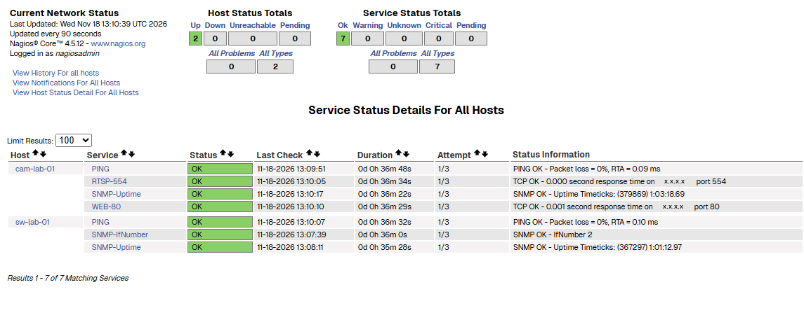
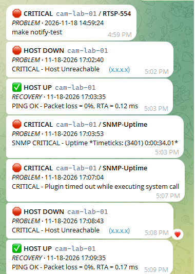

# Nagios Core + SNMPv2c — лабораторія моніторингу

Навчальний проєкт: **config-as-code** система моніторингу мережевого обладнання та IP-камер
через SNMPv2c, з алертами в Telegram і повним аудитом змін у Git.

| Рішення | Вибір | Чому |
|---|---|---|
| Ядро | **Nagios Core 4.x** (безкоштовний) | вимога «безкоштовно», SNMP «з коробки», мінімум рухомого |
| Протокол | **SNMPv2c** | підтримка камер/дешевих комутаторів |
| Джерело правди | **Git** (`inventory/hosts.yml`) | навчальний масштаб; NetBox додається пізніше без зміни схеми |
| Git-хостинг | **GitHub** + GitHub Actions | безкоштовний CI, PR-рев'ю як аудит змін |
| Алерти | **Telegram Bot API** (`curl`) | безкоштовно, мобільно |
| Середовище | **Linux + Docker Compose** | одна команда на будь-якому хості |
| Пристрої | **симулятори SNMP** (Docker) | реальних камер немає — вчимось на емуляторах |

---

## 1. Схема

```
        inventory/hosts.yml        ← SOURCE OF TRUTH (єдине місце правок)
                  │
          tools/gen.py  (генератор)
                  │
        nagios/etc/conf.d/generated/*.cfg   ← генероване, комітиться в Git
                  │
   ┌──────────────▼───────────────┐
   │  Nagios Core (контейнер)     │  check_ping / check_tcp / check_snmp
   │  UI: http://<host>:8080      │
   └──────┬────────────────┬──────┘
   SNMPv2c│161/udp         │ notify_telegram.sh
          │                ▼
  ┌───────▼────────┐   Telegram (NOC-група)
  │ sim-switch     │
  │ sim-camera     │  172.30.0.0/24 (окрема lab-мережа = VLAN моніторингу)
  └────────────────┘
          ▲
   Git push → GitHub Actions (nagios -v + перевірка актуальності генерації)
```

Ключове правило: **конфіг на проді руками не редагують**. Прод — це результат `git pull` +
`tools/deploy.sh`. Будь-яка зміна проходить через PR і `nagios -v` у CI.

Порядок деплою: `git pull` → `gen.py` → `resource.cfg` → `nagios -v` → `up -d` (без
`--build`) → `restart nagios` (див. ADR-009). Якщо `nagios -v` падає — рестарту немає.

---

## 2. Швидкий старт (Ubuntu VM з попередніх сесій)

```bash
# 1. Клонувати репозиторій
git clone https://github.com/n-work1100/test_monitoring.git
cd test_monitoring

# 2. Налаштувати секрети (у Git НЕ потрапляють)
cp .env.example .env
nano .env            # SNMP_COMMUNITY + TG_TOKEN/TG_CHAT_ID (для алертів, див. 2.1)

# 3. Підняти стек однією командою:
#    pull -> gen -> resource.cfg -> nagios -v -> up -> restart
sudo apt install -y python3-yaml     # потрібен генератору
bash tools/deploy.sh
```

`deploy.sh` сам перевіряє передумови (docker, compose-plugin, `python3-yaml`), рендерить
`nagios/etc/resource.cfg` з `.env` (`644` — файл читають CGI під користувачем `nagios`) і
**спочатку** виконує `nagios -v`; при помилці конфігу рестарту не буде.

UI: `http://<ip-ubuntu-vm>:8080/nagios/` — логін `nagiosadmin`, пароль `nagios`
(створюється при першому старті; змініть перед публічним доступом:
`docker compose exec nagios htpasswd /opt/nagios/etc/htpasswd.users nagiosadmin`).
Порт задається `NAGIOS_PORT` у `.env`; якщо 8080 зайнятий (WordPress/phpMyAdmin) — напр. `8090`.

Очікуваний стан через 3–5 хв: `sw-lab-01` та `cam-lab-01` — **UP**, 7 сервісів — **OK**
(PING, SNMP-Uptime, SNMP-IfNumber; PING, SNMP-Uptime, RTSP-554, WEB-80).

Перевірка «живий чи ні» без браузера:

```bash
curl -sI "http://localhost:${NAGIOS_PORT:-8080}/nagios/" | head -1     # очікуємо 401 Unauthorized
```

### 2.1 Telegram (для алертів)

1. `@BotFather` → `/newbot` → токен у `TG_TOKEN`.
2. Написати боту `Start` (або додати в групу й надіслати `/start@<бот>`), отримати `chat_id`
   через `getUpdates` → `TG_CHAT_ID` (у груп від'ємний).
3. Записати обидві змінні в `.env` і пересоздати контейнер (env_file читається лише при
   створенні): `docker compose up -d --force-recreate nagios` (історія в томі `nagios-var`).
4. Перевірка: `make notify-test` → 🛑 `CRITICAL cam-lab-01 / RTSP-554`.

Повна процедура й діагностика (`chat not found`, `401 Unauthorized`) — `docs/runbook.md` §2.

---

## 3. Результати (18.11.2026)

> **Історичний результат (стара VM).** Перевірено на попередній інсталяції: Ubuntu 26.04.1,
> Docker 29.1.3, Compose v2.40.3, Nagios 4.5.12. На новій VM (2026-11-24, Docker 29.10.0,
> Compose 5.8.0) усе перевіряється заново — до повторної приймання це не доказ
> працездатності нової машини.

Перевірено на живій інсталяції: Ubuntu 26.04.1, Docker 29.1.3, Compose v2.40.3,
Nagios 4.5.12, **2 хости / 7 сервісів**.

Сценарій реальної аварії (камера зупинена, потім піднята):

- `stop sim-camera` → через ≈2–3 хв `SERVICE ALERT … CRITICAL;HARD;3`,
  `HOST ALERT cam-lab-01;DOWN;HARD;3`, один `HOST NOTIFICATION` → 🛑 у Telegram;
- `start sim-camera` → `HOST ALERT … UP` + `RECOVERY` → ✅ у Telegram;
- сервісні нотифікації при DOWN хоста ядро подавляє (штатна поведінка `notifications.c`);
- перезавантаження пристрою → `SNMP-Uptime;WARNING` (0–5 хв), без CRITICAL (ADR-007);
  перевірено 19.11.2026: WARNING при uptime 2:22 → OK о 5:22.

### Service Status Details



`cam-lab-01`: PING, RTSP-554, SNMP-Uptime, WEB-80; `sw-lab-01`: PING, SNMP-IfNumber,
SNMP-Uptime. IP-адреси замасковано (`x.x.x.x`). Час на скріншоті — UTC: знято до
застосування `TZ=Europe/Kyiv`.

### Алерти в Telegram



`make notify-test` (14:59), далі два цикли DOWN → UP (17:02/17:03 та 17:08/17:09).
`SNMP-Uptime` о 17:03 ще показує CRITICAL — це стан **до** зміни порога на WARNING-only
(коміт `01c6e6c`, 17:10).

Скріншоти очищено перед публікацією: приватні IP замінено на `x.x.x.x`; токен бота й
`chat_id` у кадр не потрапляють.

### Стан приймання

**13 з 13** пунктів чек-листа (`docs/runbook.md` §7) підтверджено станом на 19.11.2026.
Два останні пункти закрито 19.11: п.2 — `curl -sI localhost:8080/nagios/ | head -1` →
`HTTP/1.1 401 Unauthorized`; п.11 — `docker compose restart sim-camera` →
`SNMP-Uptime;WARNING` (uptime 2:22), далі `OK` (5:22), **без** `CRITICAL`.

---

## 4. Як додати пристрій (робочий процес)

1. Додати запис у `inventory/hosts.yml`:

```yaml
  - name: sw-kyiv-acc-02
    alias: "Access switch, Kyiv office"
    address: 10.20.1.12
    role: switch          # switch | camera | nvr
    site: kyiv            # довільний, стає hostgroup site-kyiv
```

2. `python tools/gen.py` — оновить `nagios/etc/conf.d/generated/`.
3. `git checkout -b add-sw-kyiv-acc-02` → commit → push → **Pull Request**.
4. CI: `nagios -v` + перевірка, що генеровані файли закомічені.
5. Merge → на хості `bash tools/deploy.sh` (або `make deploy`).

Прибрати пристрій з моніторингу, не видаляючи з SoT: `monitoring: false`.

---

## 5. Що моніторимо

### Комутатор (`role: switch`)
| Сервіс | Команда | Сенс |
|---|---|---|
| PING | `check_ping` | доступність (ICMP) |
| SNMP-Uptime | `check_snmp_uptime` | `sysUpTime` < 5 хв → **WARNING** (перезавантаження) |
| SNMP-IfNumber | `check_snmp_ifnumber` | SNMP відповідає, MIB цілий |

### IP-камера (`role: camera`)
| Сервіс | Команда | Сенс |
|---|---|---|
| PING | `check_ping` | доступність |
| SNMP-Uptime | `check_snmp_uptime` | перезавантаження камери (WARNING) |
| RTSP-554 | `check_tcp!554` | основний стрім живий |
| WEB-80 | `check_tcp!80` | веб-інтерфейс/ONVIF |

### NVR (`role: nvr`)
PING + SNMP-Uptime + RTSP-554.

### Алерти
- `max_check_attempts 3` + `retry_interval 1` → короткі флапи не шумлять;
- `notification_interval 60` → нагадування раз на годину;
- `hostdependency`: камера/NVR залежить від комутатора свого `site` → коли комутатор лежить,
  Telegram не заспамлюється 20-ма «камера недоступна»;
- uptime-пороги задані **в тіках** (`-w 30000:`), бо `check_snmp` для Timeticks порівнює
  число з дужок (1 тік = 1/100 с); CRITICAL вимкнено — рестарт не є аварією (ADR-007).

---

## 6. Структура репозиторію

```
test_monitoring/
├─ inventory/hosts.yml               # SOURCE OF TRUTH
├─ tools/
│  ├─ gen.py                         # inventory -> nagios/etc/conf.d/generated
│  ├─ notify_telegram.sh             # notification command
│  └─ deploy.sh                      # pull + validate + up + restart (на Linux-хості)
├─ nagios/etc/
│  ├─ nagios.cfg                     # ядро
│  ├─ cgi.cfg                        # обов'язковий: образ не створює його при bind-mount
│  ├─ resource.cfg                   # ГЕНЕРУЄТЬСЯ deploy.sh (у .gitignore)
│  └─ conf.d/
│     ├─ 00-commands.cfg             # check_* + notify-*
│     ├─ 01-timeperiods.cfg          # 24x7 (обов'язковий: без нього nagios -v падає)
│     ├─ 05-templates.cfg            # generic-host, switch-host, camera-host...
│     ├─ 10-contacts.cfg             # контакт/група NOC (Telegram)
│     └─ generated/                  # АВТОГЕНЕРАЦІЯ, комітиться
│        ├─ hosts-<site>.cfg
│        ├─ services-<site>.cfg
│        ├─ groups.cfg
│        └─ dependencies.cfg
├─ sim/
│  ├─ snmpd/                         # симулятор комутатора (net-snmp)
│  └─ camera/                        # симулятор камери (snmpd + RTSP/80)
├─ .github/workflows/ci.yml          # nagios -v + актуальність генерації + gitleaks
├─ docker-compose.yml                # nagios + 2 симулятори; том nagios-var
├─ Makefile
├─ .env.example
└─ docs/
   ├─ decisions.md                   # 9 ADR: чому саме так
   ├─ runbook.md                     # деплой, Telegram, діагностика, чек-лист
   └─ img/                           # очищені скріншоти результатів
```

---

## 7. Безпека SNMPv2c

- community **симуляторів** — навчальне значення `lab_ro_c0mm`. Воно свідомо лежить у Git
  (`.env.example`, `sim/snmpd/snmpd.conf`, `sim/camera/snmpd.conf`) і мусить збігатися
  в усіх трьох місцях, інакше SNMP-сервіси отримають `Timeout`.
- для **реального** обладнання community — лише `.env` + `nagios/etc/resource.cfg`
  (рендерить `deploy.sh`, `chmod 644` — файл читають CGI під користувачем `nagios`,
  тому `600` ламає UI); `resource.cfg` у `.gitignore`, у Git не потрапляє.
- окрема мережа `172.30.0.0/24` = аналог VLAN моніторингу; на реальному обладнанні —
  ACL «дозволити UDP/161 лише з IP Nagios».
- `public` не використовуємо: для реальних пристроїв — довгий випадковий рядок
  (`openssl rand -base64 24`), для симуляторів — фіксоване навчальне значення.
- Telegram-токен і `chat_id` — лише в `.env`; у скріншотах і README їх немає.
- CI має `gitleaks` → випадковий коміт із токеном падає на PR.
- SNMPv3 (`authPriv`) — наступний крок, коли з'явиться обладнання з його підтримкою.

---

## 8. Наступні кроки

- [x] Приймання **13/13** (19.11.2026, див. §3).
- [ ] `check_nwc_health` (порти, помилки, CPU, PoE) для комутаторів — див. `docs/runbook.md`.
- [ ] ffprobe-пробник «стрім живий і бітрейт у нормі» (SNMP цього не показує).
- [ ] InfluxDB + Grafana для графіків.
- [ ] Міграція SoT: `inventory/hosts.yml` → NetBox + `generator.py` (схема не змінюється).
- [ ] Розподілені поллери (Mod-Gearman / Naemon) при > 500 об'єктів.
